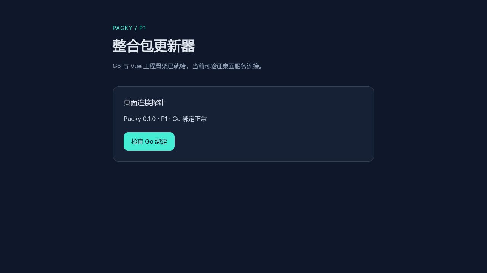

> 历史记录：2026-10-15 已切换 Rust + Tauri，Go/Wails 代码已清理。以下完成状态和命令仅适用于旧实现，不能用于当前工程验收。

# P1 初始化与验证记录

日期：2026-10-15。状态：工程/契约完成，Windows 实际运行待验收；P2 未开始。

## 已交付

- 单 Go Module（本地模块名 packy），Go 1.27.0 版本约束。
- Wails v3.0.0-beta.29 + Vue 3.5.44 + TypeScript/Vite/Tailwind 骨架，Go ProbeService.GetInfo 绑定。
- 服务端仅 GET /healthz，不启用数据库、JWT 登录或任何更新业务 API。
- 完整 API/配置 DTO、错误码、RBAC 权限目录及接口文档。
- SQLite 两份初始化迁移、权限/来源字典种子、首个超管参数化 SQL。
- [API 契约](contracts/API.md)、[数据库与权限](contracts/DATABASE.md)、[配置与锁定版本](contracts/CONFIG.md)。

## 已执行验证

环境为 Linux x86_64、Go 1.27.1-X:nodwarf5、Node 22.23.3（验证时使用临时 npm 工具环境）。本机原 Node 18 未修改。Wails CLI 放在 /tmp/packy-p1-tools，没有修改全局 PATH 或系统 GUI 库。

| 检查 | 结果与边界 |
|---|---|
| npm install 与锁文件 | 通过，生成 package-lock.json；直接依赖固定版本 |
| npm run build | 通过，含自动生成绑定、vue-tsc 和 Vite 构建 |
| Go 核心测试与全模块 gtk3 测试 | 通过；SQL 使用临时数据库 |
| go test -race ./internal/database ./internal/server | 通过 |
| go vet -tags gtk3 ./... | 通过 |
| go mod verify | 全模块校验通过 |
| 服务端实际启动与 /healthz | 通过，返回 {"status":"ok","version":"0.1.0","phase":"P1"} |
| wails3 task build | 通过，Linux gtk3 生产构建 |
| wails3 task dev | 通过，Vite 启动并且 Linux 桌面连接开发服务器 |
| Linux 桌面进程启动 | 通过；当前系统主题产生 color-mix GTK 警告，没有修改主题配置 |
| Windows x64 production 交叉编译 | 通过，产物为 PE32+ GUI x86-64 可执行文件 |
| 浏览器中的 Vue → Wails Go 绑定 | 通过，Wails server,gtk3 探针模式下点击后显示 Go 绑定正常；此模式仅用于本轮验证 |
| 文档/配置静态检查 | 原始 PRD 保持字节一致；本地链接、JSON 和 Go 格式检查通过 |

SQL 测试覆盖幂等结构迁移、权限种子、首个超管 SQL 重复执行、同名 Mod、唯一 modid、无效外键/哈希、跨包 current_release_id、modid 改动不覆盖旧快照、发布后的结构修改拒绝。

## 浏览器探针证据

截图是浏览器验证，不是 Windows 或 Linux 原生窗口截图。Linux 原生窗口只确认进程启动及开发服务器连接，未通过自动化点击验证其控件。

## 未执行与验收限制

- 当前主机是 Linux；Windows WebView2、实际窗口启动和探针按钮点击未执行。Windows 产物在 bin/Packy.exe，需在 Windows 10/11 x64 运行验证。
- 未在真实持久业务数据库初始化账号，未执行登录/注册/JWT/RBAC 业务测试。
- 未实现发布、来源下载、校验安装、客户端状态/文件读取或游戏启动器调用。
- 未生成安装器、签名、部署、提交或推送；没有展开管理端业务页面。

下一步仅完成 Windows P1 实际探针验收，或按用户后续指令开始 P2。不能将本记录的结构验证视为后续业务验收。
